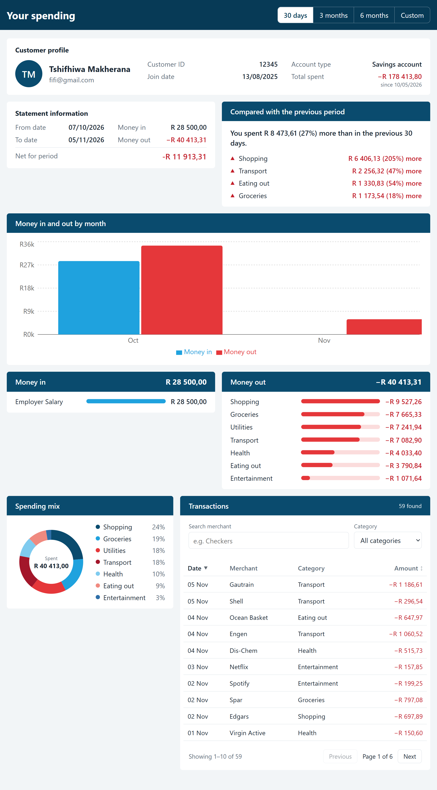
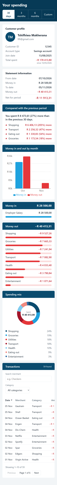
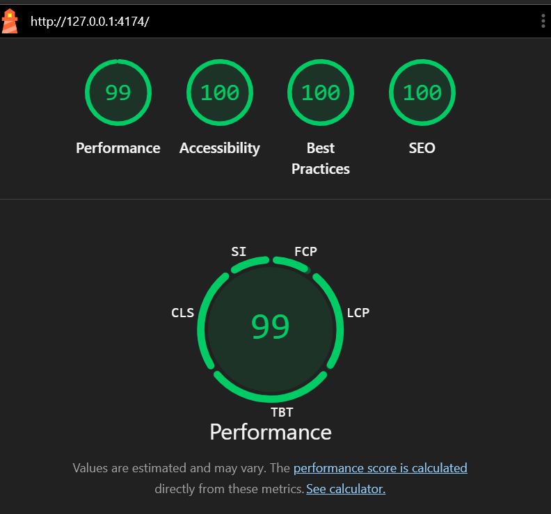

# Customer Spending Insights Dashboard

A responsive financial analytics dashboard that shows a customer where their money goes: by period, by category, compared with the previous period, and transaction by transaction. Built with React and JavaScript using mocked data.



## Features

- **Customer profile** with account details and total spending.
- **Statement information** for the selected period: money in, money out and the net amount.
- **Period selection:** last 30 days, 3 months, 6 months, or any custom date range (validated).
- **Comparison with the previous period:** a plain-language summary, such as "You spent R 2 340,00 (12%) more than in the previous 30 days", plus the categories that changed most.
- **Monthly trend chart** of money in against money out.
- **Money in and money out breakdowns**, and a **spending mix** donut by category.
- **Transactions** with merchant search, category filter, sorting by date or amount, and pagination.
- **Responsive** from small phones to desktop, with **dark mode** following the device setting.
- **Accessible:** keyboard navigation, screen reader labels, a skip link and visible focus. Lighthouse accessibility score of 100.



## Tech stack

| Area | Technology |
|---|---|
| UI | React 18, JavaScript, HTML, CSS |
| Charts | Recharts (trend chart); hand-built SVG (donut) |
| Build | Vite |
| Unit and component tests | Vitest, React Testing Library |
| End-to-end tests | Playwright (desktop Chrome and a Pixel 5 phone screen) |
| Code quality | ESLint |
| Container | Docker (multi-stage build), Nginx |
| CI | GitHub Actions |

## Run it

### With Docker (recommended)

Requirements: [Docker Desktop](https://www.docker.com/products/docker-desktop/).

```bash
docker build -t spending-insights .
docker run --rm -p 3000:80 spending-insights
```
Leave it running then open the browser
Open http://localhost:3000.

The Docker build runs the linter and unit tests first, so an image is only produced from code that passes.

### Locally for development

Requirements: Node.js 20 or later.

```bash
npm install
npm run dev
```

Open http://localhost:5173. Changes appear as you save.

## Test

Before the first end-to-end run, install the browser once with `npx playwright install chromium`. The end-to-end tests build and serve the production app automatically.

```bash
npm test             # unit and component tests (Vitest)
npm run test:e2e     # end-to-end tests in a real browser (Playwright)
npm run lint         # code quality checks (ESLint)
npm run build        # production build into dist/
```

**GitHub Actions** runs everything on every push and pull request: lint, unit tests and build, then the end-to-end tests and a Docker build in parallel. Failed end-to-end runs upload a report with traces for debugging.

## Quality



- **Lighthouse** (production build): Accessibility 100, Best Practices 100, SEO 100, Performance 99.
- **Keyboard:** every control can be reached and used without a mouse.
- **Security headers** in the Nginx container: Content Security Policy, clickjacking protection, `nosniff`, a referrer policy, a cross-origin opener policy and a permissions policy.

## Project structure

```
src/
  components/   UI components, each with a single job, plus their tests
  data/         Mock customer, transaction generator and category labels
  hooks/        Reusable React hooks (debounced search)
  services/     The data service: the app's API boundary
  utils/        Date and currency helpers
  App.jsx       Page layout, period selection, loading and error states
e2e/            Playwright end-to-end tests
public/         Static files (robots.txt)
docs/           README screenshots
```

## Design decisions

- **The data service behaves like a real API.** `spendingService.js` is asynchronous, validates its input (rejecting unknown categories, reversed date ranges and invalid pages), adds a small delay, and returns paged results. The UI therefore already handles loading and error states. Connecting a real backend means changing only this one file to call `fetch()`, with no component changes.
- **Mocked data is realistic and repeatable.** About six months of South African transactions (ZAR) are generated with a fixed random seed, so the data is the same on every load and in every test, and the dates move with the calendar, so recent periods always have data.
- **Components load their own data where it makes sense.** The transactions panel fetches its own pages, so typing in the search box doesn't reload the whole dashboard, and search is debounced by 250 ms. The customer profile loads once, because it doesn't depend on the selected period.
- **Paging resets when the question changes.** If the period, filters or sort change, the transactions go back to page 1 automatically, so users never land on an empty page.
- **Comparisons are honest about missing history.** The previous period has the same number of days as the selected one. If the mock data doesn't go back far enough, the dashboard says so rather than showing misleading figures.
- **Colours carry meaning, but never alone.** Navy for structure, blue for money in and red for money out, always paired with signs (+ and −), arrows and words, for colour-blind users.
- **Language choice.** This is a frontend project, and browsers run JavaScript, so the app is written in JavaScript with React. The brief asks for mocked data, so no Java backend is needed. The service layer is ready for one.

## Known limitations and next steps

- **No backend or authentication.** The next step would be a real API behind `spendingService.js`, with sign-in.
- **History is limited to the mock data's six months.** The longest period therefore can't be compared with the period before it.
- **HSTS** isn't set in the container because it only works over HTTPS. In production it would be set where HTTPS is handled, such as a load balancer.
- **Development dependencies:** `npm audit` reports issues in the test runner (Vitest and its helpers) and the Vite development server. These tools run only on a developer's machine and in CI; none of them are part of the built app, and `npm audit --omit=dev` reports no vulnerabilities. Fixing them requires major upgrades (Vitest 4 and the latest Vite), which are planned as a separate, fully tested change rather than rushed before submission.
- **Bundle size:** the chart library could be loaded on demand to reduce the initial download.

## Author

Tshifhiwa Makherana